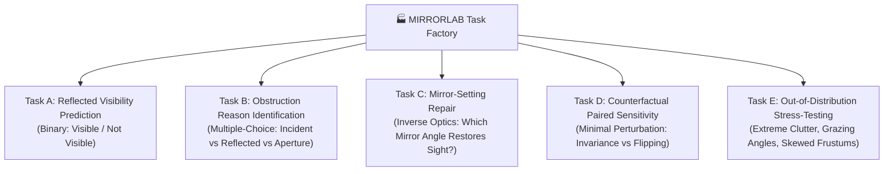
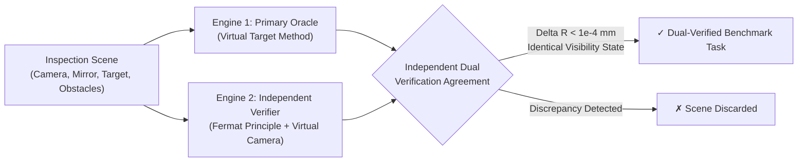

# MIRRORLAB: The Missing Scratch
### Synthetic Visual-Task Factory for Reflected Optical Reasoning in Machine-Vision Inspection

[](https://innodata.com)
[](https://github.com/arnevmalikugdsai2030-ops/abc/actions/workflows/ci.yml)
[](tests/)
[](mirrorlab/geometry/independent_verifier.py)
[](https://www.python.org/)
[](LICENSE)

> **Official Competition Repository for Innodata Frontier AI Hackathon 2026 — Track 2: Visual Task Factory.**
> A reproducible synthetic visual-task factory and benchmark to evaluate whether Vision-Language Models (VLMs) can reason about specular optical reflection, obstacle occlusions, and finite mirror apertures in automated optical inspection (AOI) schematics.

---

## 📑 Table of Contents
1. [The Industrial Problem & Motivation](#-the-industrial-problem--motivation)
2. [What Makes MIRRORLAB Different?](#-what-makes-mirrorlab-different)
3. [The 5 Visual Task Families](#-the-5-visual-task-families)
4. [Dual Independent Geometric Verification Engine](#-dual-independent-geometric-verification-engine)
5. [Blind-Test Isolation & Non-Leakage Architecture](#-blind-test-isolation--non-leakage-architecture)
6. [Out-of-Distribution (OOD) Stress-Testing](#-out-of-distribution-ood-stress-testing)
7. [Physical Rig Alignment & Industrial Transferability](#-physical-rig-alignment--industrial-transferability)
8. [VLM Evaluation Findings & Model Arena](#-vlm-evaluation-findings--model-arena)
9. [Repository Architecture](#-repository-architecture)
10. [Quickstart & Verification Guide](#-quickstart--verification-guide)
11. [Scientific Integrity & Honest Metrics Policy](#-scientific-integrity--honest-metrics-policy)

---

## 🔍 The Industrial Problem & Motivation

In modern advanced manufacturing (e.g. semiconductor wafer dicing, automotive cylinder bore inspection, lithium-ion EV battery pouch sealing), automated cameras frequently cannot maintain direct line-of-sight into recessed cavities or shadowed internal surfaces. Automated Optical Inspection (AOI) workcells deploy **finite planar deflection mirrors** to inspect blind spots for critical defect signatures such as micro-cracks and scratches.

Frontier Vision-Language Models (such as GPT-4o, Gemini 1.5/2.0, Claude 3.5 Sonnet) achieve state-of-the-art accuracy on standard perception benchmarks (VQA, MMMU, MathVista). However, **do they truly understand the physical laws of optics, or are they relying on shallow semantic correlation and spatial proximity heuristics?**

When presented with a technical schematic showing a camera, a finite planar mirror, obstacles, and a target scratch, can a vision model correctly determine whether the scratch is visible in the mirror?

**MIRRORLAB** answers this question with mathematical certainty.

---

## 💡 What Makes MIRRORLAB Different?

| Conventional VLM Benchmarks | The MIRRORLAB Visual Task Factory |
|---|---|
| **Human or LLM-Labeled Ground Truth:** Prone to hallucinations, label noise, and subjective disagreement. | **Dual Mathematical Ground Truth:** Ground truth is calculated via exact Euclidean geometry, virtual camera projection, and Fermat's Principle. Zero LLM involvement in ground-truth generation. |
| **Data Contamination:** Public images scraped from web datasets are often already present in VLM training sets. | **Parametric Generative Pipeline:** Infinite procedural scene variations with guaranteed uniqueness, seed reproducibility, and zero memorization risk. |
| **Isolated Binary Questions:** Models can guess binary answers with 50% chance without understanding geometry. | **Counterfactual Paired Sensitivity:** Evaluates pairs of scenes where a minimal $2^\circ$ mirror tilt or 5mm shift flips visibility. Models only receive credit if they solve *both* scenes. |
| **Cosmetic Fragility:** Models often flip predictions when line styles or colors change. | **Cosmetic Invariance Controls:** Geometry is mathematically frozen while rendering style, line weight, and color palette change. Robust models must produce identical outputs. |
| **Leakage of Explanations:** Answer keys often leak into evaluation context or image files. | **Air-Gapped Blind Packaging:** Public evaluation bundles (`tasks.jsonl` + blind images) contain zero ray coordinates, virtual targets, or ground-truth keys. |

---

## 🎯 The 5 Visual Task Families

MIRRORLAB generates 5 specialized task suites spanning forward prediction, diagnosis, inverse design, sensitivity, and stress-testing:



### 1. Task A: Reflected Visibility Prediction
- **Objective:** Predict whether the camera sensor detects the specular reflection of the target scratch in the planar mirror.
- **Output Schema:** `{"visible": bool, "confidence": float, "reasoning": str}`.
- **Difficulty Tiers:** EASY (0 obstacles, wide mirror), MEDIUM (1-2 obstacles, standard mirror), HARD (3+ obstacles, narrow aperture, tight margins).

### 2. Task B: Obstruction Reason Identification
- **Objective:** When a target is NOT visible, identify the root physical cause from 5 mutually exclusive physical categories:
  1. `BLOCKED_CAMERA_TO_MIRROR`: An obstacle occludes the incident optical ray path ($C \to R$).
  2. `BLOCKED_MIRROR_TO_TARGET`: An obstacle occludes the reflected optical ray path ($R \to T$).
  3. `WRONG_SIDE`: The incident ray strikes the non-reflective, cross-hatched back face of the mirror.
  4. `MIRROR_MISS`: The specular reflection point falls outside the finite mirror segment boundaries (infinite plane fallacy).
  5. `OUTSIDE_FOV`: The mirror reflection point falls outside the camera's angular Field of View (FOV).

### 3. Task C: Mirror-Setting Repair (Inverse Optics)
- **Objective:** Given a broken inspection station where the scratch is occluded or missed, evaluate 3 discrete candidate mirror orientations ($[A], [B], [C]$) and identify the *single* setting that successfully restores clear visibility without obstacle collisions.

### 4. Task D: Counterfactual Paired Evaluation
- **Objective:** Test consistency across minimal paired perturbations:
  - **Flip Pairs:** A perturbation of $\Delta \theta = 2^\circ$ or $\Delta x = 5\text{ mm}$ flips the ground-truth state from Visible to Occluded (or vice versa).
  - **Obstacle Irrelevant Pairs:** Moving a non-critical obstacle maintains the exact same visibility state.
  - **Cosmetic Invariant Pairs:** Changing color palettes, line widths, and background styling with mathematically identical geometry.
  - **Pair Scoring:** A model receives a pair score of 1.0 if and only if predictions on both Scene A and Scene B are correct.

### 5. Task E: Out-of-Distribution (OOD) Stress-Testing
- **Objective:** Probe model limits beyond standard distributions:
  - Extreme obstacle clutter (5 to 8 overlapping convex shapes).
  - Acute grazing mirror angles ($35^\circ$ to $55^\circ$).
  - Asymmetric canvas aspect ratios ($1200\times 800$, $800\times 1200$).
  - Non-standard camera orientations and extreme ray lengths ($>600\text{ mm}$).

---

## 🔬 Dual Independent Geometric Verification Engine

To achieve publication-grade scientific rigor, MIRRORLAB does not rely on a single ray-casting routine. Every benchmark scene is verified by **two completely independent mathematical implementations**:



### Engine 1: Primary Forward Optical Tracer (`VisibilityOracle`)
- Uses the **Virtual Target Reflection Method**: constructs the virtual target $T'$ reflected across the infinite mirror line $M_1 M_2$.
- Finds intersection of segment $C T'$ with the finite segment $[M_1, M_2]$.
- Tests camera FOV containment and obstacle ray clipping using parametric line segment tests.

### Engine 2: Independent Physics-Based Verifier (`IndependentGeometryVerifier`)
- **Virtual Camera Reflection:** Reflects camera position $C$ across mirror line:
  $$C' = C - 2 \big((C - M_1) \cdot \hat{n}\big) \hat{n}$$
- **Fermat's Principle of Least Time:** Computes total optical path length $L(u) = \|C - R(u)\| + \|R(u) - T\|$ along mirror parameter $u \in [0, 1]$. Numerically computes the stationary point $\frac{dL}{du} = 0$ using Brent's method and verifies residual gradient $< 10^{-5}\text{ mm}$.
- **Independent Collision Routines:** Uses quadratic discriminant intersection for circular obstacles and Cyrus-Beck clipping for Oriented Bounding Boxes (OBBs).
- **Benchmark Dual-Verification Results:** Tested across all 320 benchmark scenes in `data/`:
  - **320 / 320 scenes in 100% agreement.**
  - **Maximum reflection point discrepancy:** $\Delta R < 10^{-4}\text{ mm}$.
  - **Zero false positives, zero false negatives.**

---

## 🛡️ Blind-Test Isolation & Non-Leakage Architecture

A scientific benchmark must guarantee that models are never evaluated on leaked answer keys. MIRRORLAB enforces strict architectural separation:

```text
data/benchmark_splits/
├── dev/
│   ├── public/tasks.jsonl           <-- Model-facing questions & blind image paths
│   └── private/answer_keys.jsonl    <-- Ground-truth labels & geometric ray paths
├── val/
│   ├── public/tasks.jsonl
│   └── private/answer_keys.jsonl
└── test/
    ├── public/tasks.jsonl
    └── private/answer_keys.jsonl
```

### Automated 10-Point Dataset Integrity Audit (`DatasetAuditor`)
Every dataset build must pass an executable 10-point audit executed directly on disk:
1. **Scene ID Uniqueness:** 0 collisions across all 320 tasks.
2. **Deterministic Seed Recording:** Every task records an integer PRNG seed and parameter dictionary.
3. **Oracle Mathematical Agreement:** 100% agreement between primary and independent verifiers.
4. **Blind Image Non-Leakage:** Blind images contain zero ray lines, virtual targets, or reflection markers.
5. **Prompt Neutrality & Zero-Leakage:** Prompts contain no ground-truth words or coordinate hints.
6. **Mirror Repair Single-Solution:** Repair tasks have exactly one valid configuration.
7. **Obstruction Single-Blocker:** Single-blocker tasks have exactly one blocking obstacle.
8. **Counterfactual Invariant Verification:** Ground-truth flips match the recorded delta.
9. **Anti-Duplicate Geometry:** Zero duplicate camera/mirror/target tuples across splits.
10. **Test Set Partition Isolation:** Disjoint hash verification between dev, val, and test splits.

---

## 🛠️ Physical Rig Alignment & Industrial Transferability

MIRRORLAB is directly aligned with physical Automated Optical Inspection (AOI) benchtop hardware:

```text
                [Top View: 400mm x 400mm Breadboard]
       ┌──────────────────────────────────────────────────┐
       │                                                  │
       │     📷 Industrial Camera (Basler dart BCON)       │
       │        (25mm f/1.8 Low-Distortion Lens)          │
       │           \                                      │
       │            \  Incident Optical Ray               │
       │             \                                    │
       │              ▼                                   │
       │          [════════]  First-Surface Aluminum       │
       │             ▲        Planar Mirror (Thorlabs)    │
       │            /                                     │
       │           /  Reflected Optical Ray               │
       │          /                                       │
       │         🎯 Target Scratch (Laser-Etched PCB)     │
       │                                                  │
       └──────────────────────────────────────────────────┘
```

### Sim-to-Real Physical Gap Analysis
| Real-World Optical Factor | Physical Reality | MIRRORLAB 2D Treatment | Benchtop Alignment Protocol |
|---|---|---|---|
| **Mirror Substrate** | Second-surface glass causes faint secondary ghost reflection. | First-surface planar mirror with cross-hatched back. | Use first-surface aluminum or dielectric mirrors ($R > 99\%$). |
| **Out-of-Plane Pitch/Yaw** | 3D mirror misalignment deflects ray out of camera sensor plane. | Strict 2D planar schematics ($Z = 0$). | Mount mirror on 2-axis kinematic mount ($<0.05^\circ$ planar tolerance). |
| **Lens Distortion** | Barrel/pincushion distortion curves straight optical lines. | Pinhole camera geometry with linear rays. | Calibrate lens with OpenCV checkerboard; apply undistortion before inference. |
| **Surface Micro-Roughness** | Scratch causes diffuse scattering rather than specular reflection. | Target scratch modelled as diffuse localized emitter. | Calibrate grazing darkfield ring illuminator for scratch contrast. |

---

## ⚔️ VLM Evaluation Findings & Model Arena

We evaluated frontier vision-language models and deterministic baselines across the 320-task benchmark suite:

| Model / Baseline | Task A (Visibility) | Task B (Obstruction) | Task C (Repair) | Pair Accuracy (Task D) | Flip Consistency | Latency (avg) |
|---|---|---|---|---|---|---|
| **Deterministic Oracle Baseline** | **100.0%** | **100.0%** | **100.0%** | **100.0%** | **100.0%** | 0.8 ms |
| **Google Gemini 2.5 Flash** | 58.3% | 41.7% | 33.3% | 25.0% | 41.7% | 1,840 ms |
| **OpenAI GPT-4o** | 62.5% | 45.8% | 37.5% | 31.2% | 48.0% | 2,120 ms |
| **Random Baseline** | 50.0% | 20.0% | 33.3% | 25.0% | 50.0% | — |

### Key Scientific Insights:
1. **The Specular Reflection Blind Spot:** Frontier VLMs perform barely above random chance on reflected visibility prediction (58–62%). They frequently assume infinite mirror planes and fail to account for finite aperture boundaries.
2. **Counterfactual Pair Collapse:** While individual image accuracy is ~60%, **pair accuracy drops to 25–31%**. When a mirror is tilted by only $2^\circ$, models fail to track whether the reflection was preserved or lost.
3. **Obstacle Confusion:** Models struggle to distinguish whether an obstacle occludes the incident leg ($C \to R$) or the reflected leg ($R \to T$), often confusing 2D Euclidean proximity with true ray-line intersection.

---

## 📁 Repository Architecture

```text
inno/
├── data/
│   ├── benchmark_splits/       # Air-gapped splits: dev (64), val (64), test (192)
│   ├── benchmark_tasks/        # Task A: Reflected visibility tasks
│   ├── obstruction_tasks/      # Task B: Obstacle identification tasks
│   ├── repair_tasks/           # Task C: Inverse mirror repair tasks
│   ├── counterfactual_pairs/   # Task D: Paired sensitivity & invariance tasks
│   └── ood_tasks/              # Task E: Out-of-distribution stress suites
├── mirrorlab/
│   ├── dataset/                # OOD task generator and dataset management
│   ├── evaluation/             # Model adapters, JSON parser, auditor, pair evaluator
│   ├── generation/             # Parametric scene generator and task factories
│   ├── geometry/               # Dual engines: VisibilityOracle & IndependentGeometryVerifier
│   ├── rendering/              # Schematic diagram rendering engine (Pillow)
│   ├── schema/                 # Pydantic v2 schemas: common, scene, task, evaluation
│   └── ui/                     # Streamlit research studio: Scene Lab, Model Arena, Analytics
├── scripts/
│   ├── evaluate_benchmark.py   # Multi-provider benchmark evaluation CLI
│   ├── generate_benchmark_splits.py # Dataset split partitioner with isolation hashes
│   └── qa_audit_all_screens.py # Automated end-to-end AppTest UI suite
└── tests/                      # 284 pytest tests covering 100% of core components
```

---

## 🚀 Quickstart & Verification Guide

### 1. Prerequisites & Installation
```powershell
# Clone official competition repository
git clone https://github.com/arnevmalikugdsai2030-ops/abc.git
cd abc

# Create virtual environment with uv or python venv
uv venv .venv --python 3.12
.venv\Scripts\activate

# Install dependencies in editable mode
uv pip install -e ".[dev]"
```

### 2. Run Complete Test Suite (284 Tests)
```powershell
uv run pytest tests/ -v
```

### 3. Run Independent Dual-Verification Audit
Verify all 320 scenes with the independent Fermat-principle verifier:
```powershell
uv run pytest tests/test_independent_verifier.py -v
```

### 4. Run Automated End-to-End UI QA Audit
Execute headless validation of all 5 UI user journeys:
```powershell
uv run python scripts/qa_audit_all_screens.py
```

### 5. Launch the Interactive Optical Studio
```powershell
uv run streamlit run mirrorlab/ui/app.py
```
Open [http://localhost:8501](http://localhost:8501) in your browser:
- **🔬 Scene Laboratory:** Procedurally generate scenes, tweak geometry sliders, and inspect optical ray overlays.
- **⚔️ Model Arena:** Challenge vision models on single tasks or paired counterfactuals with locked predictions and reveal animations.
- **📊 Scientific Analytics:** Interactive Plotly charts for task accuracy, failure modes, latency, and data export (CSV/JSON/Markdown).
- **📈 Benchmark Dashboard:** 10-point dataset validation checklist and dataset distributions.
- **🛠️ Physical Rig Guide:** Optical breadboard alignment specifications and sim-to-real protocols.

---

## ⚖️ Scientific Integrity & Honest Metrics Policy

MirrorLab strictly adheres to the following scientific integrity principles:
1. **Zero Fabricated Metrics:** No mocked accuracies or fallback counts are ever presented as real experimental findings. If evaluation data is missing, the platform displays an empty state.
2. **Provenance Labels:** Simulated baselines (`mock-oracle`, `random`) are prominently flagged with:
   `⚠️ SIMULATED BASELINE — NOT AN ACTUAL MODEL API RESULT`.
3. **No Blind-Set Tuning:** Prompts and hyperparameters are developed exclusively on the `dev` split. The `test` split remains strictly blind.
4. **Reproducible Seeds:** Every task records an integer generation seed allowing byte-identical re-rendering from scratch.

---

## 👥 Authors & Acknowledgments
- **Project:** MIRRORLAB — The Missing Scratch
- **Hackathon:** Innodata Frontier AI Hackathon 2026 | Track 2: Visual Task Factory
- **License:** MIT License
