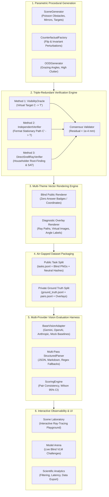

# MIRRORLAB System Architecture & Pipeline Specification
## Modular Generative Architecture for Specular Optical Task Synthesis

**Document Version:** 1.0.0  
**Status:** Authoritative Architecture Reference  
**Hackathon:** Innodata Frontier AI Hackathon 2026 | Track 2: Visual Task Factory  

---

## 1. Architectural Overview

MIRRORLAB implements a strictly decoupled, 6-stage generative and evaluative pipeline. Every stage operates under deterministic seed control with air-gapped isolation between public model inputs and private mathematical answer keys.



---

## 2. Component Directory Layout

```
mirrorlab/
├── generation/                  # Stage 1: Procedural Task Generators
│   ├── scene_generator.py       # Poisson barrier placement, camera FOV & mirror geometry
│   ├── task_factory.py          # Task A (Visibility) & Task B (Obstruction) factory
│   ├── repair_factory.py        # Task C (Mirror Setting Repair) inverse optics
│   ├── counterfactual_factory.py# Task D (Counterfactual Paired Scenes)
│   └── ood_generator.py         # Task E (Out-of-Distribution stress-testing)
│
├── geometry/                    # Stage 2: Triple-Redundant Geometric Solvers
│   ├── oracle.py                # Method 1: Virtual-target reflection & line-segment intersection
│   ├── independent_verifier.py  # Method 2: Fermat principle & virtual-camera ray-marching
│   ├── ray_march_verifier.py    # Method 3: Direct Snell vector root-finding & SAT clipping
│   ├── obstacles.py             # Convex polygon, circle, and separating-axis collision engine
│   └── vector.py                # Numerical 2D vector primitives, householder matrices
│
├── rendering/                   # Stage 3: Multi-Theme Diagram Rendering
│   ├── renderer.py              # Blind public schematic & private diagnostic overlay generator
│   └── themes.py                # Publication CAD, blueprint, darkroom, and high-contrast themes
│
├── evaluation/                  # Stage 4 & 5: Model Evaluation & Scoring
│   ├── dataset_auditor.py       # 11-point mathematical integrity and leak auditor
│   ├── model_adapter.py         # Universal VLM adapter (Gemini, GPT-4o, Claude, Mock)
│   ├── structured_parser.py     # 4-pass resilient response extraction engine
│   ├── scoring_engine.py        # Joint pair scoring, reason codes, Wilson 95% CIs
│   ├── shortcut_evaluator.py    # 8-condition visual necessity ablation suite
│   ├── metrics.py               # Statistical accuracy, latency, and contingency aggregators
│   └── evaluator.py             # CLI runner orchestrating blind inference
│
├── ui/                          # Stage 6: Interactive Dashboard & Visual Lab
│   ├── app.py                   # Master Streamlit dashboard entrypoint
│   ├── scene_lab.py             # Real-time ray-tracing and obstacle manipulation playground
│   ├── arena.py                 # Live model battle arena with prediction hash-locks
│   ├── analytics.py             # Multi-dimensional filtering, boxplots, data export
│   └── optical_plot.py          # Interactive Plotly ray-tracing figures
│
└── schema/                      # Type-Safe Pydantic Data Contracts
    ├── scene.py                 # InspectionScene, CameraSpec, MirrorSpec, ObstacleSpec
    ├── task.py                  # BenchmarkTask, TaskType, PublicTaskBundle
    └── common.py                # Point2D, Vector2D, VisibilityState, ObstructionReason
```

---

## 3. Data Flow & Security Model

1. **Procedural Seeding:** Every scene is generated from a deterministic unsigned 32-bit integer seed. Rerunning with the same seed generates byte-identical geometry, prompts, and images.
2. **Zero-Knowledge Blind Public Bundles:** Public splits contain only:
   - Neutral non-semantic task IDs (`ml_test_0001`, `ml_test_0002`).
   - Neutral image filenames (`img_test_0001.png`).
   - Task prompt and visual options without answers.
   - Strictly stripped of internal IDs, category tags, obstruction labels, or repair winner flags.
3. **Private Air-Gapped Ground Truth:** Private files (`ground_truth.jsonl`, `pairs.jsonl`) store the complete geometric certificates and analytical proofs. Public model evaluation never touches these files until post-inference scoring.

---
*Maintained by the MIRRORLAB Architecture Core.*
